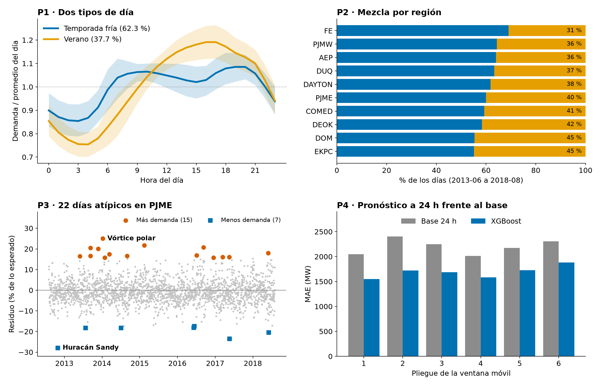
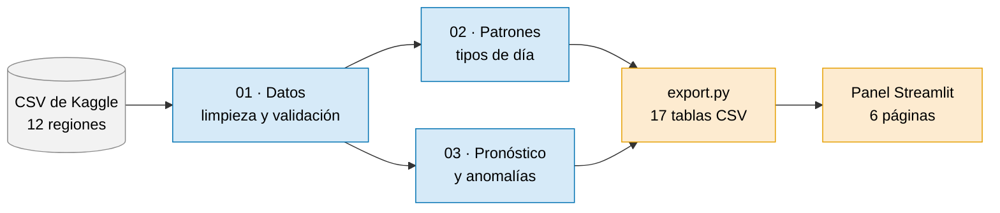
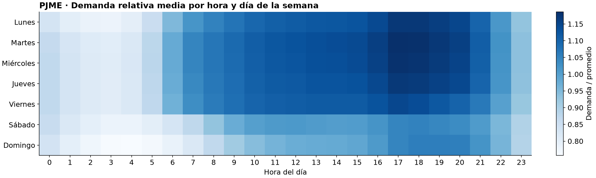

<div align="center">

# ⚡ Análisis visual de la demanda eléctrica horaria de la red PJM

**¿Qué formas de día existen, en qué se diferencian las regiones y qué días se salen de lo esperable?**

12 regiones de Estados Unidos · 1998–2018 · aprendizaje automático y visualización de datos


[](LICENSE)

[Resumen visual](#resumen-visual) · [Resultados](#resultados) · [Inicio rápido](#inicio-rápido) · [Documentación](#documentación) · [Informe](docs/IEEE/Informe_IEEE_PJM_v4.md)

| 📊 Observaciones | 🗺️ Regiones | 🌗 Tipos de día | 🚨 Días atípicos | 🎯 Mejora del MAE |
|:---:|:---:|:---:|:---:|:---:|
| **1,090,295** | **12** | **2** | **22** | **19.1 %** |
| horas validadas | de la red PJM | estacionales | en `PJME` | frente al modelo base |

</div>

---

## Resumen visual

Una respuesta gráfica por cada pregunta de investigación.



---

## Descripción

El dataset *Hourly Energy Consumption* suele usarse para pronosticar la demanda de una sola región. Este proyecto se centra en **caracterizar** cómo es la demanda. El pronóstico pasa a ser una referencia de lo esperable, y los resultados se comunican en un panel interactivo.

### Preguntas de investigación

| N.º | Pregunta | Tarea visual |
|---|---|---|
| 🔵 P1 | ¿Qué tipos de día (formas de perfil diario) existen y cómo se distribuyen en el calendario? | Descubrir patrones |
| 🟠 P2 | ¿En qué se diferencian las regiones por su mezcla de tipos de día y su estacionalidad? | Comparar |
| 🔴 P3 | ¿Qué días se desvían de la demanda esperable y a qué episodios corresponden? | Localizar anomalías |
| 🟢 P4 | ¿Cuándo y cuánto falla un pronóstico a 24 horas? | Evaluar |

### Aporte diferencial

1. **De pronosticar a caracterizar:** el aprendizaje automático (agrupamiento de perfiles diarios y detección de anomalías) se usa para obtener información, no solo precisión de pronóstico.
2. **Comparación entre 12 regiones con calidad de datos documentada:** periodos desiguales, hora de fin de intervalo, cambios de horario y continuidad entre regiones.
3. **Diseño de visualización justificado:** cada gráfico se asocia a una tarea y a un canal perceptual, y se entrega en un panel interactivo en Streamlit de seis páginas.

### Flujo del análisis



---

## Datos

- **Fuente:** [Hourly Energy Consumption (Kaggle)](https://www.kaggle.com/datasets/robikscube/hourly-energy-consumption), de Rob Mulla, con datos de PJM Interconnection.
- **Contenido:** demanda horaria en MW de 12 regiones (AEP, COMED, DAYTON, DEOK, DOM, DUQ, EKPC, FE, NI, PJME, PJMW y PJM_Load), entre 1998-04-01 y 2018-08-03.
- **Volumen:** 1,090,167 filas originales, 1,090,295 tras la limpieza.
- **Convención horaria:** `Datetime` marca el **final** de la hora. Las variables de calendario se calculan desde `Datetime − 1 h` (día operativo).
- **Periodo común:** no existe uno para las 12 regiones, 10 comparten 2013-06-01 → 2018-08-03.

Los datos crudos **no se incluyen en el repositorio**, se descargan desde Kaggle (ver [inicio rápido](#inicio-rápido)).

---

## Resultados

Cifras de la última ejecución de los notebooks, calculadas con el día operativo.

| Hallazgo | Resultado |
|---|---|
| Calidad de los datos | Sin nulos, cobertura de 99.98 % a 99.99 %, 40 duplicados y 217 horas faltantes, casi todos por cambios de horario |
| Limpieza | Las 12 regiones superan la validación (1,090,295 filas), se interpoló el 0.02 % de las horas y se excluyeron 2 días erróneos de `DEOK` |
| Convención horaria | `Datetime` marca el final de la hora, el calendario usa el día operativo |
| Hora de `COMED` | Su curva llega una hora más tarde que la del resto: es lo esperable si las series están en hora del este y `COMED` es una zona de hora central |
| Ciclo diario | Mínimo hacia las 3–4 h y máximo entre las 17 y las 19 h |
| Calendario | El fin de semana consume entre un 3.9 % y un 13.9 % menos que un laborable (≈ −9 % en promedio), un festivo cerca de un 5 % menos |
| Estacionalidad | Dos máximos anuales (verano e invierno), `EKPC` y `PJMW` son invernales (y `AEP` en menor medida), `COMED`, `DUQ`, `DEOK` y `PJME` veraniegas |
| Pronóstico a 24 h (`PJME`) | XGBoost: MAE de 1,862 MW frente a 2,300 MW del modelo base (−19.1 %), MASE de 0.86 (0.72 a 0.87 en ventana móvil de 6 pliegues) |
| Tipos de día | 2 tipos estacionales, temporada fría (62.3 %) y verano (37.7 %), con estructura débil (k = 2, silueta 0.413) |
| Días atípicos | 22 en `PJME` (z modificado > 3.5); coinciden 5 de los 8 episodios externos evaluados |

### Cuándo se consume más



Las figuras se regeneran con `python docs/img/generar_figuras.py` después de `python src/export.py`.

---

## Inicio rápido

```bash
# 1. Clonar el repositorio
git clone https://github.com/LukasGarrido/energy-consumption-analysis.git
cd energy-consumption-analysis

# 2. Crear y activar el entorno virtual
python -m venv .venv
.venv\Scripts\Activate.ps1        # Windows (PowerShell)
source .venv/bin/activate         # Linux / macOS

# 3. Instalar dependencias y el proyecto
pip install -r requirements.txt
pip install -e .

# 4. Descargar los datos (requiere la API de Kaggle) o colocarlos a mano en data/raw/
kaggle datasets download -d robikscube/hourly-energy-consumption -p data/raw --unzip

# 5. Abrir los notebooks
jupyter lab
```

Ejecuta los notebooks **en orden numérico (01 a 03)**, con *Restart & Run All*. Posteriormente, ejecuta el script de exportación (`python src/export.py`) para generar las 17 tablas que lee el panel de Streamlit. La guía completa, con las comprobaciones esperadas y la solución de problemas, está en [docs/06_guia_usuario.md](docs/06_guia_usuario.md). Se recomienda Python 3.10 a 3.12.

### Ejecutar el panel de Streamlit

Una vez ejecutados los notebooks y el script de exportación, la app puede levantarse directamente desde la raíz del proyecto:

```bash
# Opción 1: Generar o actualizar las tablas analíticas
python src/export.py

# Opción 2: Lanzar la aplicación interactiva
streamlit run app/streamlit_app.py
```

La app lee las tablas de `data/processed/panel/` sin recalcular nada. Si algún CSV falta, indica cuál y recuerda ejecutar `python src/export.py`.

### Ejecutar con Docker Compose

Con Docker en marcha y las tablas ya generadas, un solo comando construye la imagen y levanta la app en `http://localhost:8501`:

```bash
docker compose up --build -d
```

Para detenerla: `docker compose down`. Más detalles en la [guía de usuario](docs/06_guia_usuario.md#ejecución-con-docker-compose).

---

## Estructura del repositorio

<details>
<summary>Ver el árbol de directorios</summary>

```text
├── app/
│   ├── streamlit_app.py          # Punto de entrada del panel en Streamlit
│   ├── config.py                 # Constantes, paleta Okabe-Ito y resolución de rutas
│   ├── data_loader.py            # Carga con caché y conversiones de tipo
│   ├── estilos.py                # Mejoras visuales y diseño adaptativo (modo claro/oscuro)
│   ├── filtros.py                # Helpers de filtrado local y por módulo
│   ├── graficos.py               # Helpers de color y compatibilidad de API de Streamlit
│   ├── paginas/
│   │   ├── __init__.py
│   │   ├── resumen.py            # Tarjetas de indicadores y tendencia anual
│   │   ├── patrones.py           # Mapa de calor, curvas por tipo y estacionalidad mensual
│   │   ├── tipos_de_dia.py       # Curvas con bandas, calendario, barras y silueta
│   │   ├── regiones.py           # Barras apiladas y dispersión de indicadores
│   │   ├── anomalias.py          # Línea de tiempo, episodios y caso hora a hora
│   │   └── pronostico.py         # Métricas, error desglosado y real vs. pronóstico
├── data/
│   ├── raw/                      # Datos crudos (.gitkeep, excluidos por .gitignore)
│   └── processed/                # Datos limpios y resultados (.gitkeep)
│       └── panel/                # 17 tablas CSV y diccionario de datos (generadas por src/export.py)
├── docs/                         # Documentación técnica modular (compatible con Obsidian)
│   ├── 01_proyecto.md            # Problema, preguntas de investigación y objetivo general
│   ├── 02_datos.md               # Dataset, fuente, contenido y calidad de los datos
│   ├── 03_metodologia.md         # Enfoque, fases y flujo de notebooks
│   ├── 04_modelo_y_resultados.md # Hallazgos, pronóstico, agrupamiento y anomalías
│   ├── 05_decisiones.md          # Registro histórico de decisiones del proyecto
│   ├── 06_guia_usuario.md        # Guía de instalación, uso y reproducción
│   ├── 07_referencias.md         # Bibliografía y referencias respaldadas
│   ├── img/                      # Figuras del README y el script que las genera
│   │   ├── generar_figuras.py    # Genera las figuras desde las tablas del panel
│   │   ├── mapa_calor.png        # Demanda por hora y día de la semana
│   │   └── resumen.png           # Una vista por pregunta de investigación
│   └── IEEE/                     # Informe final en formato paper IEEE y figuras
│       ├── fig_*.png             # Figuras del informe (anomalías, error, regiones, silueta)
│       └── Informe_IEEE_PJM_v4.md # Informe técnico en formato paper IEEE
├── notebooks/                    # Cuadernos Jupyter en orden de ejecución
│   ├── 01_datos.ipynb            # Exploración inicial (EDA), calidad de datos, convención horaria y limpieza
│   ├── 02_patrones.ipynb         # Patrones horarios/estacionales y agrupamiento de tipos de día
│   └── 03_pronostico_anomalias.ipynb # Pronóstico de referencia (XGBoost vs base) y detección de anomalías
├── src/                          # Módulos Python reutilizables por los notebooks
│   ├── __init__.py               # Inicialización del paquete
│   ├── anomalies.py              # Residuo diario, z modificado y contraste con episodios
│   ├── cleaning.py               # Limpieza de series, deduplicación e interpolación
│   ├── config.py                 # Rutas y parámetros globales del proyecto
│   ├── data_loader.py            # Funciones de carga y lectura de datos
│   ├── export.py                 # Exportación del modelo dimensional (17 tablas CSV para el panel)
│   ├── features.py               # Día operativo, variables de calendario, rezagos y medias móviles
│   ├── modeling.py               # Partición temporal, modelos XGBoost/base, métricas y ventana móvil
│   └── profiles.py               # Perfiles diarios, elección de k y agrupamiento
├── .dockerignore                 # Archivos que se envían al construir la imagen
├── .env.example                  # Plantilla de variables de entorno
├── .gitignore                    # Configuración de exclusiones de Git
├── AGENTS.md                     # Directrices para agentes de IA y colaboradores
├── compose.yaml                  # Servicio de Docker Compose para la app de Streamlit
├── Dockerfile                    # Imagen de la app de Streamlit
├── LICENSE                       # Licencia del proyecto
├── pyproject.toml                # Configuración de empaquetado del proyecto
├── README.md                     # Descripción general del repositorio
├── requirements-app.txt          # Dependencias de la imagen Docker de la app
└── requirements.txt              # Dependencias del proyecto
```

</details>

---

## Documentación

La documentación completa está en [`docs/`](docs/01_proyecto.md):

- [01. Proyecto](docs/01_proyecto.md)
- [02. Datos](docs/02_datos.md)
- [03. Metodología](docs/03_metodologia.md)
- [04. Modelo y resultados](docs/04_modelo_y_resultados.md)
- [05. Decisiones](docs/05_decisiones.md)
- [06. Guía de usuario](docs/06_guia_usuario.md)
- [07. Referencias](docs/07_referencias.md)
- [Informe IEEE (Formato Paper)](docs/IEEE/Informe_IEEE_PJM_v4.md)

---

## Tecnologías

El proyecto se desarrolla utilizando un ecosistema de análisis de datos, modelado, visualización y gestión:

- **Procesamiento y Análisis de Datos:** Python, `pandas`, `numpy`, `scipy`, `pyarrow`.
- **Aprendizaje Automático y Modelado:** `scikit-learn` (agrupamiento k-medias y Ward, métricas), `xgboost` (pronóstico de referencia a 24 horas), `statsmodels` (descomposición STL).
- **Utilidades y Datos:** `holidays` (festivos federales de EE. UU.), `kaggle` (descarga del dataset desde la terminal).
- **Visualización y Presentación:** `Plotly`, `Matplotlib`, `Seaborn`, Streamlit (panel interactivo alimentado por un modelo en estrella en CSV) y Docker Compose (ejecución opcional del panel).
- **Entorno y Documentación:** Jupyter Notebook / JupyterLab, Git y GitHub (control de versiones), Obsidian (documentación técnica y bitácora de decisiones).

El detalle completo de métodos y herramientas está en [docs/03_metodologia.md](docs/03_metodologia.md).

---

## Limitaciones

- El dataset no incluye temperatura, el principal determinante de la demanda: los episodios atípicos se interpretan por coincidencia con eventos.
- Los tipos de día pueden resultar con una estructura débil, porque los perfiles diarios forman en parte un continuo.
- El pronóstico y la detección de anomalías se hacen solo para `PJME`.
- Las curvas de `COMED` y `NI` llegan una hora más tarde que las del resto. Se conserva la hora de la fuente porque no hay una confirmación expresa de su zona horaria, y su mezcla de tipos de día cambiaría al alinearlas ([D7](docs/05_decisiones.md)).
- Los datos llegan hasta 2018 y pueden no representar la demanda actual.

---

## Licencia

Este proyecto está bajo la licencia indicada en el archivo [LICENSE](LICENSE). Los datos pertenecen a PJM Interconnection y a sus autores.
