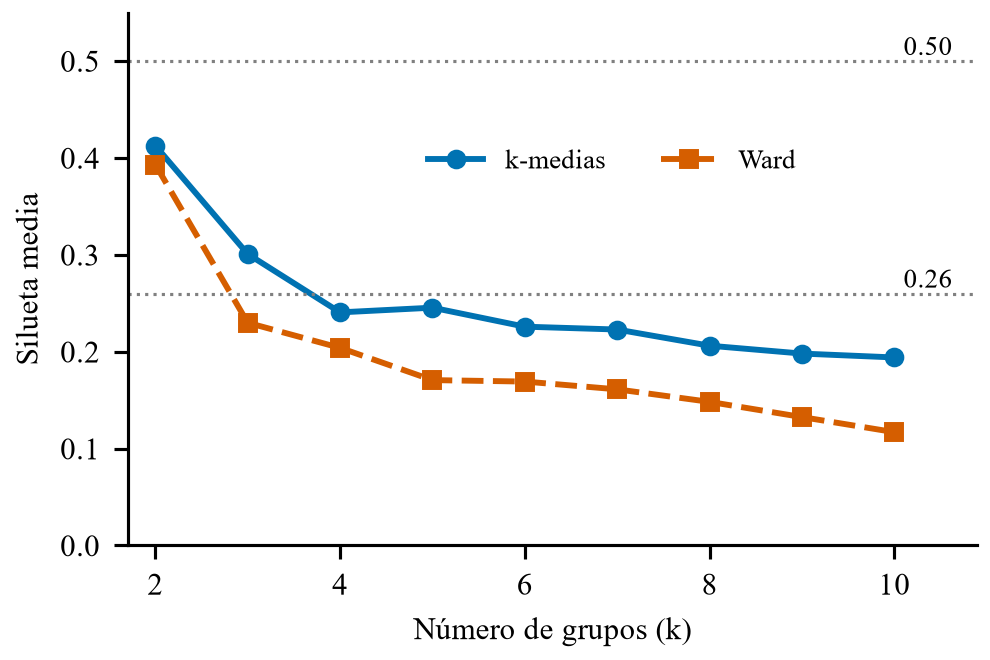
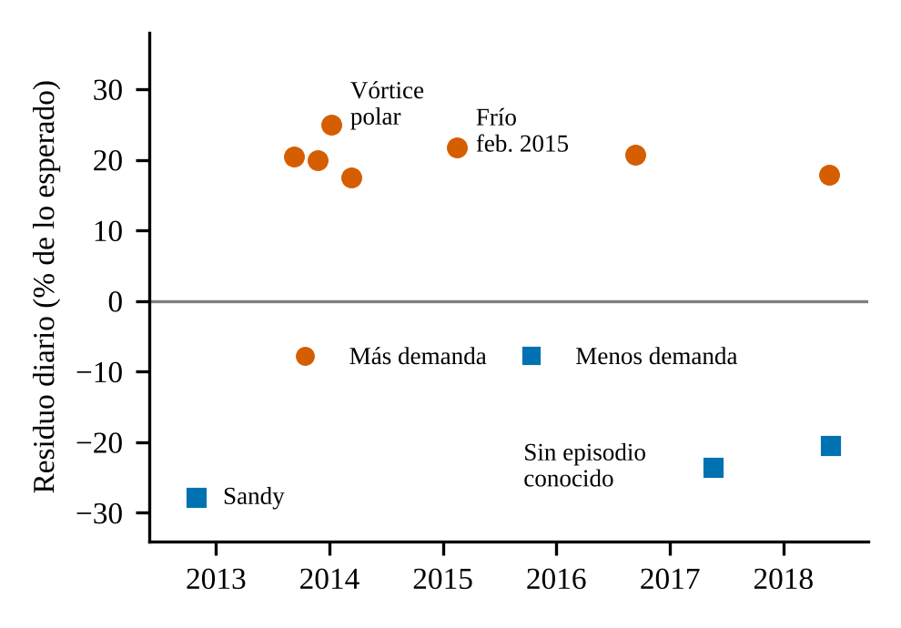
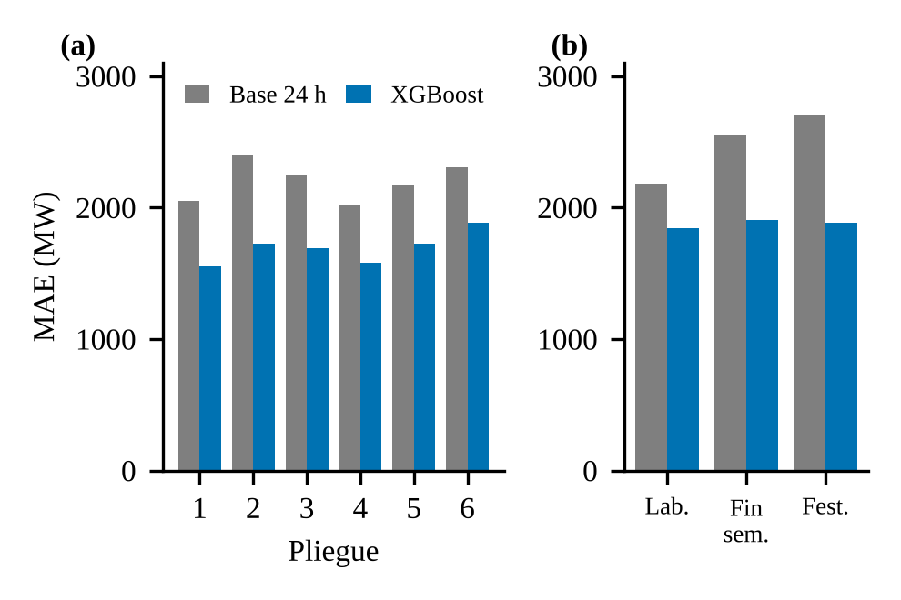

# Caracterización Visual de la Demanda Eléctrica Horaria de la Red PJM: Tipos de Día, Regiones y Días Atípicos

Lukas Garrido  
Departamento de Informática  
Universidad Técnica Federico Santa María, Concepción, Chile  
lgarrido@usm.cl

Octavio Valencia  
Departamento de Informática  
Universidad Técnica Federico Santa María, Concepción, Chile  
ovalencia@usm.cl

***Resumen*—La demanda eléctrica horaria suele analizarse para pronosticar una sola región. Este trabajo propone caracterizarla: identificar qué formas de día existen, en qué se diferencian las regiones y qué días se desvían de lo esperable, y comunicarlo mediante visualización. Se parte de 1,090,343 observaciones horarias validadas de 12 regiones de la red PJM entre 1998 y 2018, preparadas con una regla de día operativo y con un tratamiento explícito de los cambios de horario. Los perfiles diarios normalizados se agrupan con k-medias y Ward, un modelo XGBoost de pronóstico a 24 horas validado en ventana móvil define la demanda esperable, y los días cuyo residuo tiene un z modificado superior a 3.5 se marcan como atípicos. El agrupamiento halla dos tipos de día estacionales, temporada fría y verano, con una estructura débil (silueta 0.41) que no separa laborables de fines de semana. XGBoost reduce el error absoluto medio un 19 % frente al modelo base y lo supera en los seis pliegues (MASE de 0.72 a 0.87). Se detectan 22 días atípicos de 2,191 y cinco de los ocho episodios evaluados coinciden con ellos, con el signo esperado. Los resultados se exportan a 17 tablas que alimentan un panel interactivo de seis páginas en Streamlit.**

***Palabras clave*—series de tiempo, demanda eléctrica, agrupamiento de perfiles, detección de anomalías, visualización de datos, PJM**

## I. Introducción

El pronóstico de la demanda eléctrica es una tarea central en la planificación y la operación de los sistemas de potencia \[1\], y con las mediciones de alta resolución la analítica de la demanda se ha ampliado a la segmentación de clientes, el agrupamiento de perfiles y la detección de consumos anómalos \[2\]. El conjunto público *Hourly Energy Consumption* reúne la demanda horaria de 12 regiones de la red PJM entre 1998 y 2018 \[3\], y los cuadernos publicados junto a él se centran sobre todo en pronosticar la demanda de una sola región.

Caracterizar la demanda se apoya en tres líneas de trabajo. La primera es el agrupamiento de curvas de carga normalizadas, en el que k-medias y los métodos jerárquicos son referencias habituales y cuyo resultado depende de la normalización y del criterio de validación \[4\], \[5\]. La segunda es la detección de anomalías, donde una familia de métodos compara la demanda observada con la de un modelo de predicción y marca las desviaciones grandes \[6\]. La tercera es la visualización: la vista de calendario permite ubicar cada grupo a lo largo del año \[7\]. Aquí se combinan las tres, y el pronóstico a 24 horas es la referencia de lo esperable.

Se plantean cuatro preguntas: P1, ¿qué tipos de día existen y cómo se distribuyen en el calendario?; P2, ¿en qué se diferencian las regiones por su mezcla de tipos de día y su estacionalidad?; P3, ¿qué días se desvían de la demanda esperable y a qué episodios corresponden?; y P4, ¿cuándo y cuánto falla un pronóstico a 24 horas? El objetivo general es caracterizar, mediante análisis visual apoyado en aprendizaje automático, los patrones de demanda de las 12 regiones y comunicarlos en un panel interactivo. Los objetivos específicos son: (i) preparar una base horaria validada y comparable entre regiones; (ii) identificar tipos de día y ubicarlos en el calendario; (iii) detectar días atípicos a partir de los residuos fuera de muestra de un pronóstico de referencia; y (iv) diseñar vistas justificadas por la tarea para P1 a P4. Las hipótesis son: H1, los perfiles normalizados se agrupan por estación y por tipo de día (laborable o fin de semana); y H2, los días atípicos coinciden con eventos climáticos extremos documentados, con más demanda de la esperada en frío y calor extremos y menos en huracanes.

## II. Datos

### A. Fuente y cobertura

Los datos provienen del conjunto de Kaggle \[3\], que recopila la demanda publicada por PJM Interconnection, operador de la red de todo o parte de 13 estados del este de EE. UU. y Washington D. C. \[8\]. Cada región tiene un CSV con la fecha y hora (*Datetime*, que marca el final de la hora \[8\]) y el consumo en MW, entre 1998-04-01 y 2018-08-03, con entre 32,896 (PJM_Load) y 145,366 (PJME) filas por región y 1,090,167 en total. PJM_Load termina en 2002-01 y NI en 2011-01; las otras 10, llamadas vigentes, comparten el periodo 2013-06-01 → 2018-08-03, y solo entre ellas se comparan regiones.

### B. Calidad y preparación

No hay valores nulos y todas las regiones cubren entre 99.98 % y 99.99 % de sus horas. Casi todas las irregularidades se deben al cambio de horario: 4 fechas con las 02:00 duplicada en 10 regiones (primer domingo de noviembre de 2014 a 2017) y 217 horas faltantes, de las que 126 son la hora inexistente de primavera, 82 la de otoño que falta hasta 2013 y 9 no se relacionan con el cambio de horario (el 2010-12-10 00:00 en siete regiones y dos horas de AEP). El 0 MW inicial de FE se recortó; se conservaron el valle real de 514 MW de EKPC, y los atípicos altos continuos según el rango intercuartílico \[9\], que son picos reales.

La limpieza promedia las horas repetidas, reindexa a un calendario horario completo, interpola linealmente huecos de hasta 2 horas (los únicos observados), convierte en vacíos los valores menores o iguales a 0 y los atípicos aislados de una hora (a más de 50 % del promedio de sus horas vecinas, con vecinas que difieren a lo sumo 25 % y z modificado respecto del patrón de mes y hora mayor que 3.5 \[16\]) y recorta los vacíos de los extremos. Se unificaron 40 duplicados, se interpolaron 220 horas (217 faltantes y 3 atípicos aislados de AEP, DOM y PJMW, 0.02 %) y se recortó 1 fila. Quedan 1,090,343 filas en formato largo, y las 12 regiones superan la validación de continuidad horaria.

## III. Metodología

El proyecto sigue una estructura inspirada en CRISP-DM \[10\], con un notebook por etapa, funciones reutilizables, semilla fija (42) y parámetros centralizados en un archivo de configuración.

### A. Día operativo

Como *Datetime* marca el final de la hora, la hora 24 de cada día caería en el día siguiente. Por eso las variables de calendario (fecha, hora de 0 a 23, día de la semana, mes, estación, fin de semana y festivo federal) se calculan sobre *Datetime* menos una hora. Para comparar formas, el consumo se divide por el promedio de su región, y la tendencia se examina con una media móvil de 365 días. El desfase horario medido entre −3 y +3 h muestra que COMED y NI llegan una hora más tarde; se conserva la hora de la fuente.

### B. Agrupamiento de perfiles diarios

Cada día se representa con 24 valores divididos por el promedio del día, de modo que se agrupa la forma y no el nivel. Se comparan k-medias y Ward \[4\], \[5\] para k entre 2 y 10 con el coeficiente de silueta \[11\], sobre una muestra reproducible de 10,000 días, y se elige la mayor silueta con grupos de al menos 5 % de los días. La estructura es razonable con una silueta de 0.51 o más y débil entre 0.26 y 0.50 \[12\]. Se reporta la concordancia entre métodos (índice de Rand ajustado) y la distancia de cada día al centro de su grupo. Un solo agrupamiento sirve a las 12 regiones, lo que permite la matriz región por tipo de día.

### C. Pronóstico de referencia

El pronóstico a 24 horas de PJME usa XGBoost \[13\] con variables de calendario, rezagos de 24, 48 y 168 h (nunca menores que el horizonte, para evitar fuga de datos) y medias móviles desplazadas, y se compara con los modelos ingenuos de 24 h y 168 h. La validación usa una ventana móvil con entrenamiento creciente y 6 pliegues de 12 meses entre 2012-08 y 2018-08, que incluyen el huracán Sandy y los fríos de 2014 y 2015, de modo que cada hora se predice una sola vez fuera de muestra. Se reportan MAE, RMSE, MAPE y MASE con la escala del ingenuo de 24 h \[14\], \[15\]; un MASE menor que 1 mejora al ingenuo, y el criterio de éxito es superar al base en todos los pliegues. XGBoost se eligió por su eficacia con datos tabulares, su capacidad no lineal y su rapidez; Prophet, ARIMA y las redes recurrentes se descartaron por su costo, ya que el pronóstico es solo una referencia.

### D. Detección de días atípicos

El residuo diario se expresa como porcentaje de la predicción fuera de muestra, y un día es atípico si su z modificado supera 3.5 en valor absoluto:

$$z = \frac{0.6745\,(x - \text{mediana})}{\text{MAD}} \qquad (1)$$

donde MAD es la mediana de las desviaciones absolutas respecto de la mediana \[16\]. Se reporta la sensibilidad a los umbrales 3, 4 y 5, y la lista se contrasta con episodios externos documentados; los que caen fuera del rango de los residuos se marcan como no evaluados.

### E. Diseño del panel

Cada vista parte de la tarea de la pregunta que responde \[17\] y de la precisión de los canales visuales \[18\], \[19\]: posición sobre una escala común, escalas compartidas en vistas comparativas, color secuencial de un matiz para magnitudes, categórico de pocos colores (k ≤ 8) para tipos de día y sin gráficos circulares. Los resultados se exportan como un modelo en estrella de 17 tablas CSV, con un diccionario de 109 columnas, para un panel de seis páginas (resumen, patrones, tipos de día, regiones, anomalías y pronóstico) con filtros de región, estación y fecha. El panel se implementa en Streamlit, que permite explorar las vistas de forma dinámica desde el navegador, sin licencias y con el mismo código Python del análisis.

## IV. Resultados

### A. P1: tipos de día

El ciclo diario tiene su mínimo entre las 3 y las 4 h y su máximo entre las 17 y las 19 h (a las 18 h en 7 de las 10 regiones, a las 17 h en DUQ y PJME y a las 19 h en EKPC). El fin de semana consume entre 3.9 % (EKPC) y 13.9 % (DAYTON) menos que un laborable, cerca de 9 % en promedio, y un festivo cerca de 5 % menos.

El agrupamiento de los 45,430 perfiles diarios elige k-medias con k = 2 y una silueta de 0.413, es decir, una estructura débil (Fig. 1); con k = 3 baja a 0.30 y desde k = 4 queda bajo 0.26, y ni k = 3 ni k = 4 separan el fin de semana (sus grupos tienen entre 21 % y 33 % de sábados y domingos). Ward no supera a k-medias en ningún k y concuerda con ella en 0.73 (índice de Rand ajustado). Los grupos reúnen 62.3 % y 37.7 % de los días.

**Fig. 1.** Silueta media frente a k. Las líneas punteadas marcan los umbrales 0.26 y 0.51.

Según su curva media y su ubicación en el calendario, el primer grupo, temporada fría (octubre a mayo), tiene un mínimo a las 3 h, un pico nocturno hacia las 19 h y una amplitud diaria cercana a 0.2 del promedio; el segundo, verano (junio a septiembre), tiene una sola curva con pico hacia las 17 h y una amplitud cercana a 0.4. Son tipos estacionales y no de calendario, por lo que H1 se cumple solo en su parte estacional: el 28.9 % y el 28.1 % de los días de cada grupo son sábado o domingo, casi el 28.6 % esperado sin relación, y los festivos no se concentran (3.2 % y 2.8 %). Una hipótesis no verificada es que el efecto de fin de semana es sobre todo de nivel y desaparece al normalizar cada perfil.

### B. P2: diferencias entre regiones

Entre las 10 regiones vigentes, el coeficiente de variación va de 17 % a 26 % y las correlaciones diarias, de 0.56 a 0.96. La razón invierno/verano va de 0.92 (DUQ) a 1.20 (EKPC): EKPC y PJMW (1.12) son invernales, y en menor medida AEP (1.06), mientras que DUQ, COMED, DEOK y PJME son veraniegas. La tendencia es estable o de ligera baja (PJME, −9 % entre 2007 y 2017; AEP, −13 %).

En el periodo común, la proporción de días de verano va de 31 % (FE) a 45 % (DOM y EKPC) (Fig. 2a) y sigue a la amplitud diaria de cada región, no a su sesgo estacional (Fig. 2b): EKPC es la más invernal y aun así tiene 45 % de días de verano. La mezcla de AEP, DAYTON y PJMW cambia entre 3 y 4 puntos respecto del historial completo, por eso se reportan ambas.

**Fig. 2.** Comparación de regiones en el periodo común: (a) mezcla de tipos de día; (b) razón invierno/verano frente a amplitud diaria.

### C. P3: días atípicos

Se marcan 22 días atípicos de PJME entre 2012-08 y 2018-08, el 1.0 % de los 2,191 evaluados: 15 con más demanda de la esperada y 7 con menos. La lista es sensible al umbral (52 días con 3, 9 con 4 y 2 con 5) y no se concentra en una estación (de 0.7 % a 1.3 %), aunque el error es más disperso en invierno y verano (MAD de ≈ 3.8 % frente a 2.5–2.7 %). La Fig. 3 muestra los diez de mayor magnitud, encabezados por el huracán Sandy (2012-10-30, −27.9 %) y el vórtice polar (2014-01-07, +25.0 %).

**Fig. 3.** Los diez días atípicos de mayor magnitud de PJME.

De diez episodios externos, todos con fuente para sus fechas, dos quedan fuera del rango de los residuos (2006 y 2011) y cinco de los ocho evaluados coinciden con días atípicos, todos con el signo esperado por H2: el huracán Sandy (\|z\| = 5.74), el calor de septiembre de 2013 (4.58), los dos vórtices polares de enero de 2014 (5.55 y 3.57) y el frío de febrero de 2015 (4.85). No se detectan la ola de calor de julio de 2013, el frío de enero de 2018 ni Jonas; una explicación no confirmada es que en episodios largos los rezagos ya incorporan el nivel alto.

Los otros 16 días no coinciden con ningún episodio conocido. Los 6 de menos demanda caen entre mayo y julio: uno es el festivo del 4 de julio de 2014 y los otros cinco son compatibles con días templados con menos aire acondicionado (hipótesis sin verificar); en conjunto, la tasa de atípicos en festivos (1.5 %) no difiere de la del resto (1.0 %). Por su forma, 8 de los 22 (36 %) quedan lejos de su grupo (sobre el percentil 95 de la distancia), unas siete veces la tasa del resto (≈ 5 %), aunque la correlación de Spearman entre \|z\| y la distancia es casi nula (0.02); los otros 14 solo difieren en el nivel.

### D. P4: error del pronóstico

En la partición única con corte en 2017-01-01, XGBoost obtiene un MAE de 1,862 MW frente a 2,300 MW del base de 24 h y 3,511 MW del de 168 h (19.1 % menos que el primero), un RMSE de 2,513 MW (3,134 y 4,794 MW), un MAPE de 5.89 % (7.32 % y 10.99 %) y un MASE de 0.86, mientras que los dos modelos base quedan sobre 1 (1.06 y 1.63). En la ventana móvil supera al base en los seis pliegues (Fig. 4a), con una mejora del MAE de 18.3 % a 28.3 % y un MASE de 0.72 a 0.87; el pliegue más reciente es el de menor mejora. La ganancia es mayor en festivos (30 %) y fines de semana (25 %) que en laborables (15 %) (Fig. 4b).

El error es mayor por la tarde (≈ 2,350 MW a las 17 h frente a ≈ 1,500 MW de madrugada) y en junio y julio, y menor en octubre, noviembre y abril. El 71 % de la importancia recae en el consumo del día anterior a la misma hora: el modelo es esencialmente «ayer» con correcciones por tipo de día. El día de mayor error, el 2017-05-20, es también atípico (−23.6 %), y en 4 de los 10 días de mayor error el base supera a XGBoost.

**Fig. 4.** Error del pronóstico: (a) MAE por pliegue de la ventana móvil; (b) MAE por tipo de día en la partición única. Gris: base 24 h; azul: XGBoost.

## V. Discusión y limitaciones

La demanda se organiza sobre todo por la estación, y las regiones difieren más en cómo reparten sus días entre las dos formas y en su sesgo estacional que en su forma básica. Con una silueta entre 0.26 y 0.50 \[12\], los tipos de día son una simplificación útil de un continuo de perfiles y no categorías separadas. El pronóstico mejora de forma estable al base, pero depende casi por completo del día anterior, y el detector encuentra los eventos más extremos, aunque no todos.

Las limitaciones son cinco. Primero, el pronóstico y las anomalías se hacen solo para PJME. Segundo, no se usa la temperatura, principal determinante de la demanda \[1\], por lo que el modelo falla en olas de calor y de frío y esos errores son los que se marcan como atípicos. Tercero, la estructura de los grupos es débil, k = 2 solo captura la estación (un k mayor tampoco separa el fin de semana); en cambio, los grupos son estables entre 20 semillas (índice de Rand ajustado de 0.997 a 1.000). Cuarto, NI y COMED podrían ser la misma zona en periodos consecutivos (cociente de niveles de 1.00 en el empalme del 2011-01-01), pero se mantienen como series separadas para no asumirlo, y no hay un periodo común a las 12 regiones. Quinto, la curva de COMED y NI llega una hora más tarde, lo esperable si las series están en hora del este y esas zonas son de hora central; se conserva la hora de la fuente porque no está confirmado, y alinearlas cambiaría de grupo el 1.33 % de los días y subiría el grupo de temporada fría de 60.4 % a 67.1 % en COMED y de 52.3 % a 64.3 % en NI.

Entre las fortalezas están la reproducibilidad (semilla fija y parámetros centralizados), la validación fuera de muestra con control de fuga de datos, la comparación en un periodo común, el reporte de la sensibilidad al umbral y de la estructura débil tal como resulta, y el contraste con episodios documentados.

## VI. Conclusiones

Se caracterizó la demanda horaria de 12 regiones de la red PJM con un flujo reproducible que prepara 1,090,343 observaciones validadas y combina agrupamiento, pronóstico de referencia y detección de anomalías. En respuesta a P1, los perfiles diarios forman dos tipos, temporada fría y verano, con una estructura débil según los umbrales de \[12\] (silueta 0.41) y sin separar laborables de fines de semana, por lo que H1 se confirma solo en su parte estacional. Respecto de P2, las regiones difieren en su estacionalidad (EKPC y PJMW invernales, y AEP en menor medida; DUQ, COMED, DEOK y PJME veraniegas) y en su proporción de días de verano, de 31 % a 45 %. Para P3, cinco episodios coinciden con los 22 días atípicos con el signo esperado, lo que apoya H2 para los eventos más extremos y respalda el uso de los residuos de un modelo de predicción como criterio de anomalía \[6\]. Para P4, el pronóstico logra un MAE de 1,862 MW y un MASE de 0.86, mejor que el ingenuo \[14\], supera al base en los seis pliegues y falla más por la tarde, en verano y ante cambios bruscos, coherente con el peso de la temperatura en la demanda \[1\].

Como trabajo futuro se propone extender el pronóstico y las anomalías a las demás regiones, incorporar la temperatura, probar un k mayor para separar el fin de semana, y resolver la unión de NI y COMED y la alineación horaria. El código y la guía de reproducción están disponibles en [Energy-consumption-analysis](https://github.com/LukasGarrido/energy-consumption-analysis).

## Referencias

1.  T. Hong and S. Fan, “Probabilistic electric load forecasting: A tutorial review,” *Int. J. Forecasting*, vol. 32, no. 3, pp. 914–938, 2016, doi: 10.1016/j.ijforecast.2015.11.011.

2.  Y. Wang, Q. Chen, T. Hong, and C. Kang, “Review of smart meter data analytics: Applications, methodologies, and challenges,” *IEEE Trans. Smart Grid*, vol. 10, no. 3, pp. 3125–3148, 2019.

3.  R. Mulla, “Hourly Energy Consumption,” Kaggle, 2018. \[Online\]. Available: https://www.kaggle.com/datasets/robikscube/hourly-energy-consumption. Accessed: Nov. 25, 2026.

4.  G. Chicco, “Overview and performance assessment of the clustering methods for electrical load pattern grouping,” *Energy*, vol. 42, no. 1, pp. 68–80, 2012, doi: 10.1016/j.energy.2011.12.031.

5.  A. Rajabi, M. Eskandari, M. J. Ghadi, L. Li, J. Zhang, and P. Siano, “A comparative study of clustering techniques for electrical load pattern segmentation,” *Renew. Sustain. Energy Rev.*, vol. 120, Art. no. 109628, 2020, doi: 10.1016/j.rser.2019.109628.

6.  Y. Himeur, K. Ghanem, A. Alsalemi, F. Bensaali, and A. Amira, “Artificial intelligence based anomaly detection of energy consumption in buildings: A review, current trends and new perspectives,” *Appl. Energy*, vol. 287, Art. no. 116601, 2021.

7.  J. J. van Wijk and E. R. van Selow, “Cluster and calendar based visualization of time series data,” in *Proc. IEEE Symp. Information Visualization (InfoVis ’99)*, 1999, pp. 4–9.

8.  PJM Interconnection, “MSRS report format documentation: Hourly load data.” \[Online\]. Available: https://www.pjm.com/-/media/markets-ops/settlements/msrs/desc/msrs-customer-report-documentation-hourly-load-data.ashx. Accessed: Nov. 25, 2026.

9.  J. W. Tukey, *Exploratory Data Analysis*. Reading, MA, USA: Addison-Wesley, 1977.

10. P. Chapman *et al.*, *CRISP-DM 1.0: Step-by-Step Data Mining Guide*. CRISP-DM Consortium, 2000.

11. P. J. Rousseeuw, “Silhouettes: A graphical aid to the interpretation and validation of cluster analysis,” *J. Comput. Appl. Math.*, vol. 20, pp. 53–65, 1987.

12. L. Kaufman and P. J. Rousseeuw, *Finding Groups in Data: An Introduction to Cluster Analysis*. New York, NY, USA: Wiley, 1990.

13. T. Chen and C. Guestrin, “XGBoost: A scalable tree boosting system,” in *Proc. 22nd ACM SIGKDD Int. Conf. Knowledge Discovery and Data Mining*, 2016, pp. 785–794, doi: 10.1145/2939672.2939785.

14. R. J. Hyndman and A. B. Koehler, “Another look at measures of forecast accuracy,” *Int. J. Forecasting*, vol. 22, no. 4, pp. 679–688, 2006.

15. R. J. Hyndman and G. Athanasopoulos, *Forecasting: Principles and Practice*, 3rd ed. Melbourne, Australia: OTexts, 2021. \[Online\]. Available: https://otexts.com/fpp3/. Accessed: Nov. 25, 2026.

16. B. Iglewicz and D. C. Hoaglin, *How to Detect and Handle Outliers*. Milwaukee, WI, USA: ASQC Quality Press, 1993.

17. T. Munzner, *Visualization Analysis and Design*. Boca Raton, FL, USA: CRC Press, 2014.

18. W. S. Cleveland and R. McGill, “Graphical perception: Theory, experimentation, and application to the development of graphical methods,” *J. Amer. Statist. Assoc.*, vol. 79, no. 387, pp. 531–554, 1984.

19. J. Heer and M. Bostock, “Crowdsourcing graphical perception: Using Mechanical Turk to assess visualization design,” in *Proc. SIGCHI Conf. Human Factors in Computing Systems*, 2010, pp. 203–212.
