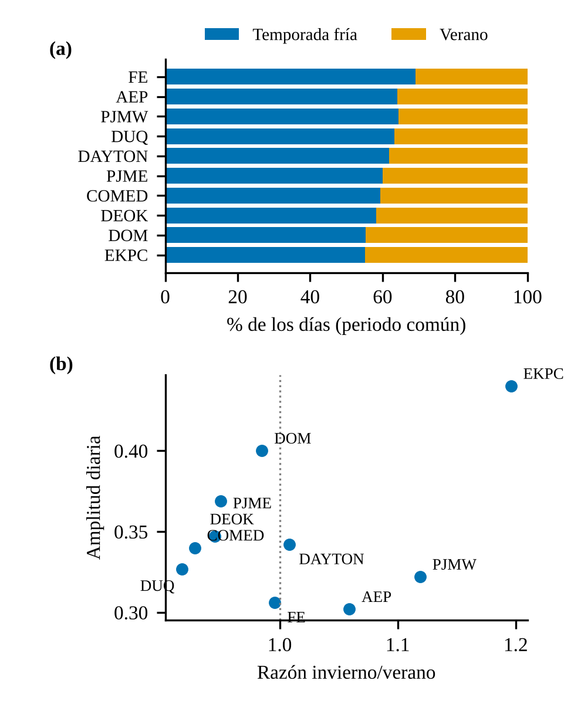

# Caracterización Visual de la Demanda Eléctrica Horaria de la Red PJM: Tipos de Día, Regiones y Días Atípicos

Lukas Garrido  
Ing.informática  
USM, Concepción Chile  
correo@usm.cl

Octavio Valencia  
Ing.informática  
USM, Concepción Chile  
correo@usm.cl

**Resumen**—La demanda eléctrica horaria suele analizarse para pronosticar una sola región. Este trabajo propone caracterizarla: identificar qué formas de día existen, en qué se diferencian las regiones y qué días se desvían de lo esperable, y comunicarlo mediante visualización. Se parte de 1,090,343 observaciones horarias validadas de 12 regiones de la red PJM entre 1998 y 2018, preparadas con una regla de día operativo y con un tratamiento explícito de los cambios de horario. Los perfiles diarios normalizados se agrupan con k-medias y Ward, un modelo XGBoost de pronóstico a 24 horas validado en ventana móvil define la demanda esperable, y los días cuyo residuo tiene un z modificado superior a 3.5 se marcan como atípicos. El agrupamiento halla dos tipos de día estacionales, temporada fría y verano, con una estructura débil (silueta 0.41) que no separa laborables de fines de semana. XGBoost reduce el error absoluto medio un 19 % frente al modelo base y lo supera en los seis pliegues (MASE de 0.72 a 0.87). Se detectan 22 días atípicos de 2,191 y cinco de los ocho episodios evaluados coinciden con ellos, con el signo esperado. Los resultados se exportan a 17 tablas que alimentan un prototipo interactivo de seis páginas.

**Palabras clave**—series de tiempo, demanda eléctrica, agrupamiento de perfiles, detección de anomalías, visualización de datos, PJM

## Introducción

El pronóstico de la demanda eléctrica es una tarea central en la planificación y la operación de los sistemas de potencia \[1\]. El conjunto de datos público *Hourly Energy Consumption* reúne la demanda horaria de 12 regiones de la red PJM entre 1998 y 2018 \[2\], y los trabajos previos que lo usan se centran, sobre todo, en pronosticar la demanda de una sola región \[3\]–\[6\].

Este trabajo caracteriza cómo es la demanda. La literatura sobre curvas de carga muestra que agrupar perfiles diarios permite identificar patrones de consumo \[7\], y la vista de calendario permite ubicar cada grupo a lo largo del año \[8\]. Aquí el pronóstico a 24 horas es la referencia de lo esperable contra la que se miden las desviaciones.

Se plantean cuatro preguntas: P1, ¿qué tipos de día existen y cómo se distribuyen en el calendario?; P2, ¿en qué se diferencian las regiones por su mezcla de tipos de día y su estacionalidad?; P3, ¿qué días se desvían de la demanda esperable y a qué episodios corresponden?; y P4, ¿cuándo y cuánto falla un pronóstico a 24 horas? El objetivo general es caracterizar, mediante análisis visual apoyado en aprendizaje automático, los patrones de demanda de las 12 regiones y comunicarlos en un panel interactivo.

## Datos

### Fuente y cobertura

Los datos provienen del sitio de PJM Interconnection, organización regional de transmisión que opera la red de todo o parte de 13 estados del este de EE. UU. y Washington D. C. \[2\], \[9\]. Cada región tiene un archivo CSV con la fecha y hora (*Datetime*) y el consumo en megavatios (MW), entre 1998-04-01 y 2018-08-03, con entre 32,896 (PJM_Load) y 145,366 (PJME) filas por región y 1,090,167 en total. La convención de PJM marca el final de cada hora \[9\].

Las regiones no cubren los mismos años: PJM_Load termina en 2002-01 y NI en 2011-01, mientras que las otras 10, llamadas vigentes, llegan hasta 2018-08-03 y comparten el periodo 2013-06-01 → 2018-08-03. Por eso las comparaciones entre regiones se hacen solo entre las 10 vigentes en ese periodo, y NI y PJM_Load se analizan por separado.

### Calidad de los datos

Ninguna región tiene valores nulos y todas cubren entre 99.98 % y 99.99 % de las horas de su periodo. Casi todas las irregularidades se explican por el cambio de horario de EE. UU.: 4 fechas con la hora de las 02:00 duplicada y con valores distintos en 10 regiones (el primer domingo de noviembre de 2014 a 2017) y 217 horas faltantes, entre 6 y 30 por región. De ellas, 126 son la hora inexistente de primavera, 82 la hora de otoño que falta hasta 2013 y 9 no tienen relación con el cambio de horario: el 2010-12-10 00:00 en siete regiones, lo que sugiere una falla común de la fuente, y dos horas de AEP.

El 0 MW de FE es el primer registro de su serie y se trató como vacío y se recortó; el mínimo de 514 MW de EKPC es una racha de varias horas en la madrugada de un domingo, es decir, un valle real, y se conservó. Los atípicos altos según el criterio del rango intercuartílico \[10\] son picos reales de demanda. Dos valores bajos aislados, uno de DOM y uno de PJMW, se conservaron por ser solo dos valores en más de un millón de filas.

### Preparación

La limpieza aplica reglas explícitas: las horas repetidas se promedian; la serie se reindexa a un calendario horario completo; los huecos de hasta 2 horas, que son los únicos observados, se interpolan linealmente; los valores menores o iguales a 0 pasan a vacío y los vacíos de los extremos se recortan. Se unificaron 40 duplicados, se interpolaron 217 horas (0.02 %) y se recortó 1 fila. El resultado son 1,090,343 filas en formato largo (fecha, MW, región), y las 12 regiones superan la validación de continuidad horaria.

## Metodología

El proyecto avanza por fases, con un notebook por fase y funciones reutilizables, siguiendo una estructura inspirada en CRISP-DM \[11\]. La reproducibilidad se apoya en una semilla fija (42) y en parámetros centralizados en un único archivo de configuración.

### Día operativo y variables de calendario

Como *Datetime* marca el final de la hora, la hora 24 de cada día caería en el día siguiente y los perfiles de 24 horas quedarían desfasados. Por eso las variables de calendario (fecha, hora de 0 a 23, día de la semana, mes, estación, fin de semana y festivo federal) se calculan sobre *Datetime* menos una hora. Para comparar formas entre regiones, el consumo se divide por el promedio de su región. La tendencia y la estacionalidad se examinan con una media móvil de 365 días y con la descomposición STL \[12\]. Se mide además el desfase horario de cada región entre −3 y +3 h: COMED y NI llegan una hora más tarde que el resto, y se conserva la hora de la fuente.

### Agrupamiento de perfiles diarios

Cada día se representa con 24 valores divididos por el promedio del día, de modo que el agrupamiento captura la forma y no el nivel. Se comparan k-medias y Ward, métodos habituales en el agrupamiento de curvas de carga \[7\], para k entre 2 y 10. La calidad se mide con el coeficiente de silueta \[13\] sobre una muestra reproducible de 10,000 días, y se elige la mayor silueta entre las combinaciones cuyos grupos tengan al menos 5 % de los días. La estructura se considera razonable con una silueta superior a 0.50 y débil entre 0.26 y 0.50 \[14\]. Se reporta la concordancia entre ambos métodos con el índice de Rand ajustado y la distancia de cada día al centro de su grupo. Un solo agrupamiento sirve a las 12 regiones, lo que permite construir la matriz región por tipo de día, calculada en el historial completo y en el periodo común.

### Pronóstico de referencia

El pronóstico a 24 horas de PJME usa XGBoost \[15\] con variables de calendario, rezagos de 24, 48 y 168 h (nunca menores que el horizonte, para evitar fuga de datos) y medias móviles desplazadas. Se compara con dos modelos base: el ingenuo de 24 h y el de 168 h. La validación usa una ventana móvil con entrenamiento creciente, con 6 pliegues de 12 meses sin solapamiento entre 2012-08 y 2018-08, periodo que incluye el huracán Sandy, el vórtice polar de 2014 y el frío de 2015, de modo que cada hora se predice una sola vez fuera de muestra. Se reportan MAE, RMSE, MAPE y MASE, este último con la escala del pronóstico ingenuo estacional de 24 h \[16\], \[17\]; un MASE menor que 1 indica que el modelo mejora al ingenuo. El criterio de éxito es superar al modelo base en todos los pliegues con un MASE menor que 1. Se eligió XGBoost por su eficacia con datos tabulares, su capacidad de captar relaciones no lineales y su entrenamiento rápido; se descartaron Prophet, ARIMA y las redes recurrentes por su costo de ajuste, ya que el pronóstico es una referencia.

### Detección de días atípicos

El residuo de cada día se expresa como porcentaje de la predicción, a partir de los residuos fuera de muestra del pronóstico. Un día se marca como atípico si el valor absoluto de su z modificado supera 3.5. Este se calcula como

$$z = \frac{0.6745\,(x - \text{mediana})}{\text{MAD}} \qquad (1)$$

donde MAD es la mediana de las desviaciones absolutas respecto de la mediana \[18\]. El cálculo usa todos los días de la región, se reporta la sensibilidad a los umbrales 3, 4 y 5, y la lista se contrasta con episodios externos con fuente. Los episodios fuera del rango de los residuos se marcan como no evaluados y no como no detectados. Se espera que las olas de frío y de calor den residuos positivos y que el huracán Sandy dé residuos negativos.

### Diseño del panel

Cada vista se diseña a partir de la tarea de la pregunta que responde \[19\] y de la precisión relativa de los canales visuales \[20\], \[21\]: se prefiere la posición sobre una escala común, las vistas comparativas comparten escala, el color es secuencial de un solo matiz para magnitudes y categórico de pocos colores (k ≤ 8) para los tipos de día, y se evitan los gráficos circulares. Los resultados de los notebooks se exportan como un modelo en estrella de 17 tablas CSV, validado sin claves huérfanas y con un diccionario de 146 columnas, que alimenta un panel de seis páginas: resumen, patrones, tipos de día, regiones, anomalías y pronóstico. Los filtros de región y estación actúan sobre todas las tablas; el de fecha, solo sobre las tablas diarias y horarias. Un prototipo en Streamlit con las seis páginas consume las mismas tablas; el panel final en Power BI está por construir.

## Resultados

### P1: tipos de día

El análisis por hora del día y día de la semana muestra un ciclo diario con mínimo entre las 3 y las 4 h y máximo entre las 17 y las 19 h (a las 18 h en 7 de las 10 regiones). El fin de semana consume entre 3.9 % (EKPC) y 13.9 % (DAYTON) menos que un laborable, cerca de 9 % en promedio, y un festivo cerca de 5 % menos.

El agrupamiento de los 45,430 perfiles diarios elige k-medias con k = 2, con una silueta media de 0.413, es decir, una estructura débil (Fig. 1). Con k = 3 la silueta baja a 0.30 y desde k = 4 queda por debajo de 0.26. Ward no supera a k-medias en ningún k y coincide con ellas en 0.82 (índice de Rand ajustado). Los dos grupos reúnen 62.3 % y 37.7 % de los días.

**Fig. 1.** Silueta media frente a k. Las líneas punteadas marcan los umbrales 0.26 y 0.50.

Según la curva media de cada tipo (con su banda entre los percentiles 10 y 90) y su ubicación en el calendario, el primer grupo, temporada fría (octubre a mayo), tiene un mínimo a las 3 h, un pico nocturno hacia las 19 h y una amplitud diaria cercana a 0.2 del promedio. El segundo, verano (junio a septiembre), tiene una sola curva con pico hacia las 17 h y una amplitud cercana a 0.4.

Son tipos estacionales y no de calendario: el 28.9 % y el 28.1 % de los días de cada grupo son sábado o domingo, casi el 28.6 % que se esperaría sin relación, y los festivos tampoco se concentran (3.2 % y 2.8 %). Una hipótesis, que no se verificó, es que el efecto de fin de semana es sobre todo de nivel y desaparece al dividir cada perfil entre el promedio del día.

### P2: diferencias entre regiones

Entre las 10 regiones vigentes, la variabilidad de la demanda (coeficiente de variación) va de 17 % a 26 % y las correlaciones diarias, de 0.56 a 0.96. La razón invierno/verano va de 0.92 (DUQ) a 1.20 (EKPC): EKPC y PJMW son invernales, y DUQ, COMED, DEOK y PJME, veraniegas. La tendencia es estable o de ligera baja (PJME, −9 % entre 2007 y 2017; AEP, −13 %).

En el periodo común, la proporción de días de verano va de 31 % (FE) a 45 % (DOM y EKPC) (Fig. 2a). Sigue a la amplitud diaria de cada región y no a su sesgo estacional (Fig. 2b): EKPC es la más invernal (1.20) y aun así tiene 45 % de días de verano. La mezcla de AEP, DAYTON y PJMW cambia entre 3 y 4 puntos respecto del historial completo, por eso se reportan ambas.

**Fig. 2.** Comparación de regiones en el periodo común: (a) mezcla de tipos de día; (b) razón invierno/verano frente a amplitud diaria.

### P3: días atípicos

Con el criterio de z modificado superior a 3.5 se marcan 22 días atípicos de PJME entre 2012-08 y 2018-08, el 1.0 % de los 2,191 evaluados: 15 con más demanda de la esperada y 7 con menos. La lista es sensible al umbral (52 días con 3, 9 con 4 y 2 con 5) y no se concentra en una estación (de 0.7 % a 1.3 %), aunque el error es más disperso en invierno y verano (MAD de ≈ 3.8 % frente a 2.5–2.7 % en otoño y primavera). La Fig. 3 muestra los diez de mayor magnitud, encabezados por el huracán Sandy (2012-10-30, −27.9 %) y el vórtice polar (2014-01-07, +25.0 %).

**Fig. 3.** Los diez días atípicos de mayor magnitud de PJME.

El contraste con diez episodios externos con fuente da cinco coincidencias: el huracán Sandy (\|z\| = 5.74), el calor de septiembre de 2013 (4.58), los dos vórtices polares de enero de 2014 (5.55 y 3.57) y el frío de febrero de 2015 (4.85). Tres episodios no coinciden y dos (2006 y 2011) quedan fuera del rango de los residuos y no se evalúan. En los cinco que coinciden el signo es el esperado. No se detectan la ola de calor de julio de 2013, el frío de enero de 2018 ni la tormenta Jonas (con fechas sin verificar); una explicación posible, no confirmada, es que en episodios largos los rezagos del modelo ya incorporan el nivel alto. Además, 16 de los 22 días no coinciden con ningún episodio conocido: los 5 de menos demanda que se listan caen entre mayo y julio, compatible con días templados que usan menos aire acondicionado (hipótesis sin verificar), y la tasa de atípicos en festivos (1.5 %) no difiere de la del resto (1.0 %). Por la forma del perfil, solo 8 de los 22 (36 %) son lejanos a su grupo, frente a cerca del 5 % del resto; los otros 14 se distinguen únicamente por tener más o menos demanda de la esperada.

### P4: error del pronóstico

En la partición única de PJME con corte en 2017-01-01, XGBoost obtiene un MAE de 1,862 MW frente a 2,300 MW del modelo base de 24 h y 3,511 MW del de 168 h, una reducción de 19.1 % frente al primero. Su RMSE es de 2,513 MW (3,134 y 4,794 MW en los modelos base), su MAPE de 5.89 % (7.32 % y 10.99 %) y su MASE de 0.86, mientras que los dos modelos base quedan por encima de 1 (1.06 y 1.63). En la ventana móvil de 6 pliegues, XGBoost supera al base en todos (Fig. 4a): la mejora del MAE va de 18.3 % a 28.3 % y el MASE, de 0.72 a 0.87, con el pliegue más reciente como el de menor mejora. La ganancia es mayor en festivos (30 %) y fines de semana (25 %) que en laborables (15 %) (Fig. 4b).

El error de XGBoost es mayor por la tarde (cerca de 2,350 MW a las 17 h frente a unos 1,500 MW de madrugada) y en junio y julio, y menor en octubre, noviembre y abril. El 71 % de la importancia de las variables recae en el consumo del día anterior a la misma hora, de modo que el modelo es esencialmente «ayer» con correcciones por tipo de día. El día de mayor error, el 2017-05-20, es también atípico (−23.6 %), y en 4 de los 10 días de mayor error el modelo base supera a XGBoost (dos en invierno, uno en primavera y uno en verano).

**Fig. 4.** Error del pronóstico: (a) MAE por pliegue de la ventana móvil; (b) MAE por tipo de día en la partición única. Gris: base 24 h; azul: XGBoost.

## Discusión y limitaciones

La demanda de las 12 regiones se organiza sobre todo por la estación: la forma del día cambia entre la temporada fría y el verano, y las regiones difieren más en cuánto reparten sus días entre ambas formas y en su sesgo estacional que en su forma básica. El pronóstico mejora de forma estable al modelo base, pero depende casi por completo del día anterior, y el detector encuentra los eventos más extremos aunque no todos. Según la interpretación de la silueta \[14\], un valor entre 0.26 y 0.50 indica una estructura débil, de modo que los tipos de día se leen como una simplificación útil de un continuo de perfiles y no como categorías separadas.

El estudio tiene limitaciones. Primero, el pronóstico y la detección de anomalías se hacen solo para PJME, la única región con residuos. Segundo, no se usa la temperatura, principal determinante de la demanda \[1\], por lo que el pronóstico falla en olas de calor y de frío y esos errores son los que el método marca como atípicos. Tercero, la estructura de los grupos es débil, k = 2 solo captura la estación, y falta evaluar un k mayor y la estabilidad con distintas semillas. Cuarto, NI y COMED podrían ser la misma zona en periodos consecutivos (cociente de niveles de 1.00 y empalme el 2011-01-01), pero se guardan por separado hasta confirmarlo, PJMW no continúa a PJM_Load (cociente de 0.17) y no existe un periodo común a las 12 regiones. Quinto, la curva de COMED y NI llega una hora más tarde, lo esperable si las series están en hora del este y esas zonas son de hora central, y podría separar tipos de día por la hora y no por la forma; la decisión de alinearlas sigue abierta.

Entre las fortalezas están el diseño pensado para reproducirse (semilla fija y parámetros centralizados), la validación fuera de muestra con control de fuga de datos, la comparación en un periodo común, el reporte de la sensibilidad al umbral y de la estructura débil tal como resulta, y el contraste con episodios con fuente.

## Conclusiones

Se caracterizó la demanda horaria de 12 regiones de la red PJM con un flujo reproducible que prepara 1,090,343 observaciones validadas y combina agrupamiento, pronóstico de referencia y detección de anomalías. En respuesta a P1, los perfiles diarios forman dos tipos, temporada fría y verano, con una estructura débil según los umbrales de silueta de \[14\] (0.41) y sin separar laborables de fines de semana. Respecto de P2, las regiones difieren con claridad en su estacionalidad (EKPC y PJMW invernales; DUQ, COMED, DEOK y PJME veraniegas) y en la proporción de días de verano, de 31 % a 45 %. Para P3, se detectan 22 días atípicos de PJME y cinco episodios coinciden con ellos con el signo esperado, encabezados por el huracán Sandy y el vórtice polar de 2014. Para P4, el pronóstico alcanza un MAE de 1,862 MW y un MASE de 0.86 (menor que 1, es decir, mejor que el pronóstico ingenuo \[16\]), supera al base en los seis pliegues y falla más por la tarde, en verano y ante cambios bruscos de condiciones.

Como trabajo futuro se propone extender el pronóstico y las anomalías a las demás regiones, incorporar la temperatura, probar un k mayor para separar el fin de semana, resolver la unión de NI y COMED y la alineación horaria, y completar el panel en Power BI. El código y la guía de reproducción están disponibles en [Energy-consumption-analysis](https://github.com/LukasGarrido/energy-consumption-analysis).

## Referencias

1.  T. Hong and S. Fan, “Probabilistic electric load forecasting: A tutorial review,” *Int. J. Forecasting*, vol. 32, no. 3, pp. 914–938, 2016, doi: 10.1016/j.ijforecast.2015.11.011.

2.  R. Mulla, “Hourly Energy Consumption,” Kaggle, 2018. \[Online\]. Available: https://www.kaggle.com/datasets/robikscube/hourly-energy-consumption

3.  G. Cordova Pou, “EnergyConsumptionForecast,” GitHub repository. \[Online\]. Available: https://github.com/gonzalo-cordova-pou/EnergyConsumptionForecast

4.  pranavsp108, “time-series-forcasting,” GitHub repository. \[Online\]. Available: https://github.com/pranavsp108/time-series-forcasting

5.  panambY, “Hourly_Energy_Consumption,” GitHub repository. \[Online\]. Available: https://github.com/panambY/Hourly_Energy_Consumption

6.  “How to forecast time series data using any supervised learning model,” *Towards Data Science*. \[Online\]. Available: https://towardsdatascience.com/how-to-forecast-time-series-data-using-any-supervised-learning-model-02dd62cd4bda

7.  G. Chicco, “Overview and performance assessment of the clustering methods for electrical load pattern grouping,” *Energy*, vol. 42, no. 1, pp. 68–80, 2012, doi: 10.1016/j.energy.2011.12.031.

8.  J. J. van Wijk and E. R. van Selow, “Cluster and calendar based visualization of time series data,” in *Proc. IEEE Symp. Information Visualization (InfoVis ’99)*, 1999, pp. 4–9.

9.  PJM Interconnection, “MSRS report format documentation: Hourly load data.” \[Online\]. Available: https://www.pjm.com/-/media/markets-ops/settlements/msrs/desc/msrs-customer-report-documentation-hourly-load-data.ashx

10. J. W. Tukey, *Exploratory Data Analysis*. Reading, MA, USA: Addison-Wesley, 1977.

11. P. Chapman *et al.*, *CRISP-DM 1.0: Step-by-Step Data Mining Guide*. CRISP-DM Consortium, 2000.

12. R. B. Cleveland, W. S. Cleveland, J. E. McRae, and I. Terpenning, “STL: A seasonal-trend decomposition procedure based on loess,” *J. Official Statistics*, vol. 6, no. 1, pp. 3–73, 1990.

13. P. J. Rousseeuw, “Silhouettes: A graphical aid to the interpretation and validation of cluster analysis,” *J. Comput. Appl. Math.*, vol. 20, pp. 53–65, 1987.

14. L. Kaufman and P. J. Rousseeuw, *Finding Groups in Data: An Introduction to Cluster Analysis*. New York, NY, USA: Wiley, 1990.

15. T. Chen and C. Guestrin, “XGBoost: A scalable tree boosting system,” in *Proc. 22nd ACM SIGKDD Int. Conf. Knowledge Discovery and Data Mining*, 2016, pp. 785–794, doi: 10.1145/2939672.2939785.

16. R. J. Hyndman and A. B. Koehler, “Another look at measures of forecast accuracy,” *Int. J. Forecasting*, vol. 22, no. 4, pp. 679–688, 2006.

17. R. J. Hyndman and G. Athanasopoulos, *Forecasting: Principles and Practice*, 3rd ed. Melbourne, Australia: OTexts, 2021. \[Online\]. Available: https://otexts.com/fpp3/

18. B. Iglewicz and D. C. Hoaglin, *How to Detect and Handle Outliers*. Milwaukee, WI, USA: ASQC Quality Press, 1993.

19. T. Munzner, *Visualization Analysis and Design*. Boca Raton, FL, USA: CRC Press, 2014.

20. W. S. Cleveland and R. McGill, “Graphical perception: Theory, experimentation, and application to the development of graphical methods,” *J. Amer. Statist. Assoc.*, vol. 79, no. 387, pp. 531–554, 1984.

21. J. Heer and M. Bostock, “Crowdsourcing graphical perception: Using Mechanical Turk to assess visualization design,” in *Proc. SIGCHI Conf. Human Factors in Computing Systems*, 2010, pp. 203–212.
